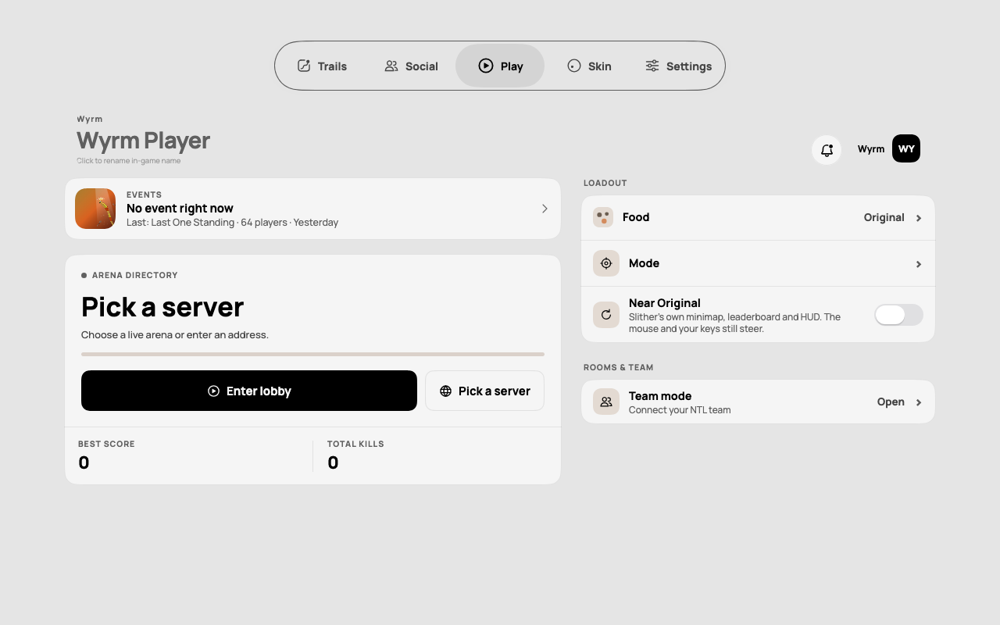
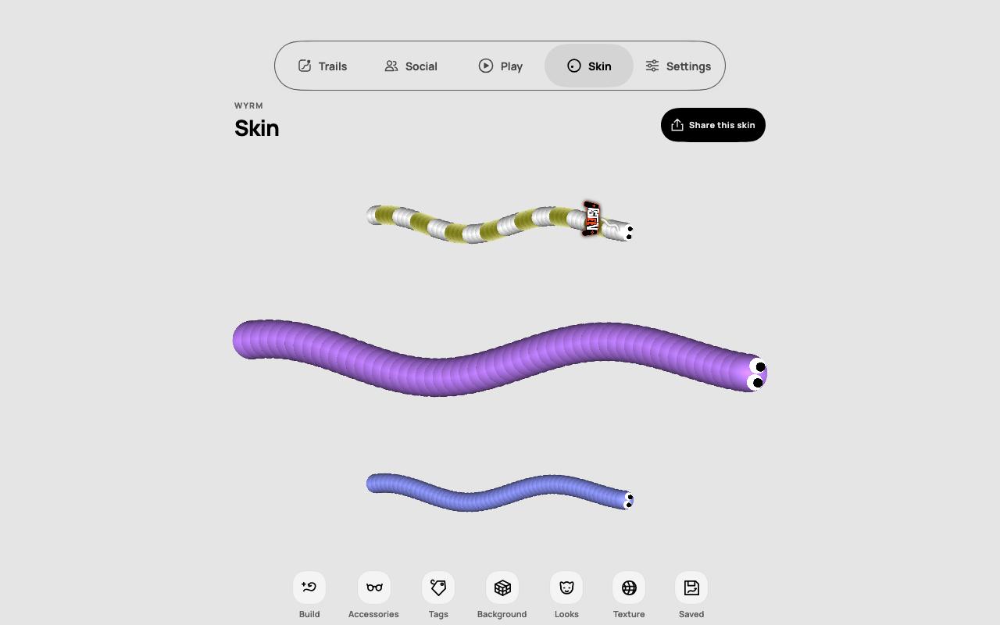

<p align="center">
  
</p>

<h1 align="center">Wyrm for Mac</h1>

<p align="center">
  The slither game app I've been building, now on the Mac.<br>
  One app for both Intel and Apple Silicon. Needs macOS 12 Monterey or newer.
</p>

<p align="center">
  <a href="https://github.com/disis-om/wyrm-mac/releases/latest"><b>⬇&nbsp; Download the latest version</b></a>
</p>

<p align="center">
  
</p>

---

Hey! This is the Mac version of Wyrm. Same account, same skins, same friends
as on your phone or Windows PC. Log in and your settings follow you.

This page is only for downloads, there's no code here.

<p align="center">
  &nbsp;
  
</p>

## Which file should I get?

Go to the [latest release](https://github.com/disis-om/wyrm-mac/releases/latest)
and you'll see two files:

| File | What it is |
| --- | --- |
| `Wyrm-<version>-mac-universal.dmg` | **The normal installer.** Pick this one if you're not sure. |
| `Wyrm-<version>-mac-universal-portable.zip` | Portable. Unzip it and run Wyrm from any folder you like. |

## Installing

1. Download the `.dmg` and double-click it.
2. Drag **Wyrm** onto the **Applications** folder in that window.
3. Eject the installer (right-click it on your desktop, then Eject).
4. Open Wyrm from Applications or Launchpad.

Please don't run Wyrm straight from the installer window. It works, but it
can't update itself from there.

## "Wyrm Not Opened" the first time? That's normal

I haven't paid Apple to notarize Wyrm yet, so the first time you open it
your Mac will say something like *"Apple could not verify Wyrm is free of
malware"*. Nothing is wrong with the app, macOS just doesn't know me. You
only have to do this once:

1. Open Wyrm. When the warning shows up, click **Done** (not Move to Trash!).
2. Open **System Settings** (Apple menu › System Settings).
3. Click **Privacy & Security** in the sidebar.
4. Scroll all the way down to the **Security** part. You'll see
   *"Wyrm was blocked to protect your Mac."*
5. Click **Open Anyway**.
6. Type your Mac password (or use Touch ID), then click **Open Anyway** once more.

That's it. From now on Wyrm opens like any other app.

> On older macOS (Monterey, Ventura, Sonoma) there's a shortcut: right-click
> Wyrm in Applications, choose **Open**, then click **Open** again.

<details>
<summary>Comfortable with Terminal? There's a one-line way too.</summary>

<br>

After moving Wyrm to Applications, paste this into Terminal and press Return:

```bash
xattr -dr com.apple.quarantine /Applications/Wyrm.app
```

It just removes the "downloaded from the internet" flag, so macOS stops
asking. Then open Wyrm normally.

</details>

## Updates

You don't need to come back here for new versions. Wyrm checks by itself, and
when there's a new one you'll get a card in the app. Click **Update now**, it
downloads, checks the file, closes, and opens again on the new version.

You can also check yourself in **Settings › Version**. Turn on
**Beta updates** there if you want new stuff a bit earlier than everyone else.

If Wyrm says it can't update, it's almost always because it's running from the
installer or from Downloads. Move it to Applications and try again.

Every update is signed by me, and Wyrm won't install anything whose
signature, size or checksum doesn't match.

## Something not working?

Send me a message in Wyrm or on Discord and tell me your Mac model and macOS
version. I'll take a look.

---

<p align="center">© 2026 OM Rajput</p>
